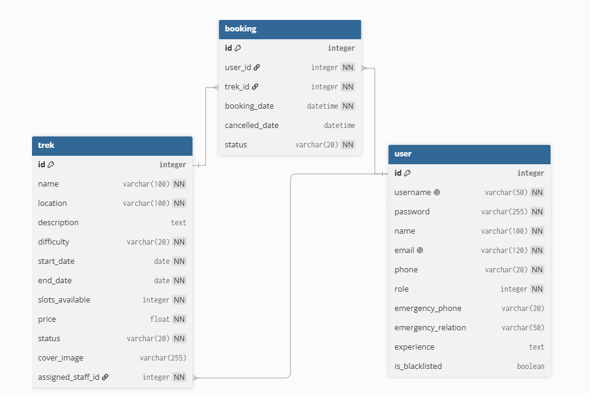

# TrekAarohan-Nexus

A Trekking Management Application handling trek approvals, slot availability, and booking tracking. Built on a decoupled stack using SQLite, a VueJS SPA, a Flask REST API, Redis, and Celery for async task processing.

## Features
- **Admin Dashboard**: Manage all treks, assign staff, and oversee all system users and bookings.
- **Staff Dashboard**: Manage assigned treks, update trek status, and manage participants.
- **Trekker Dashboard**: Browse available treks, book slots, and track past and upcoming adventures.
- **Stateless Authentication**: Secure login using JSON Web Tokens (JWT) to manage user sessions.
- **Robust Validation**: Backend constraints to prevent overbooking and invalid data entry.

---

## Setup Instructions

### 0. Pre-requisites
Ensure that following  are installed:
- **Python 3.x**
- **Node.js & npm**
- **Redis Server**
- **MailHog**

### 1. Start Redis server on WSL terminal
```bash
sudo service redis-server start
redis-cli MONITOR
```

### 2. Start MailHog server on Windows terminal
```bash
mailhog.exe
```
*(View intercepted emails by navigating to `http://localhost:8025` in browser).*

### 3. Setup & Run the Backend API
```bash
# 1. Navigate to the backend directory
cd backend

# 2. Create and activate a virtual environment
python -m venv venv
venv\Scripts\activate

# 3. Install Python dependencies
pip install -r requirements.txt

# 4. Initialize the SQLite database and default Admin account
python init_db.py

# 5. Start the Flask REST API
python app.py
```
*(The API status can be checked at `http://127.0.0.1:5000/api/ping`)*

### 4. Start the Celery Worker
```bash
cd backend
venv\Scripts\activate

celery -A worker.celery_app worker --loglevel=info --pool=solo
```

### 5. Start the Celery Beat Scheduler
```bash
cd backend
venv\Scripts\activate

celery -A worker.celery_app beat -s instance/celerybeat-schedule --loglevel=info
```

### 6. Setup & Run the Frontend SPA
```bash
# 1. Navigate to the frontend directory
cd frontend

# 2. Install Node dependencies
npm install

# 3. Start the Vue development server
npm run dev
```
*(The Frontend UI will be live at `http://localhost:5173/`)*

---

## Default Admin Account

Once the database is initialized, one can log in using the pre-created Admin account:
- **Username:** admin
- **Password:** admin123

From the Admin Dashboard, start creating Treks and registering new Trek Staffs!

---

## Architecture

### Entity-Relationship Diagram



### Technologies and Frameworks Used

| Technology / Library | Purpose |
| :--- | :--- |
| **Vue.js v3** | Reactive frontend framework for building the Single Page Application (SPA). |
| **Flask** | Core backend web framework providing RESTful API endpoints. |
| **Flask-JWT-Extended** | Secure, stateless JSON Web Token authentication. |
| **SQLAlchemy** | Object Relational Mapper (ORM) for SQLite database. |
| **Vanilla CSS** | Custom frontend styling and finer control over aesthetics. |
| **Werkzeug (Security)** | Used for password hashing and verification to ensure secure user authentication. |
| **Celery** | Distributed task queue for asynchronous background jobs (emails, CSV exports). |
| **Redis** | In-memory data store acting as the message broker for Celery and cache for API routes. |
| **MailHog** | Local SMTP server for testing and debugging automated emails. |

---

## Author

[भाग्य ज्योति (Bhagya Jyoti)](https://github.com/BhagyaJyoti22006)

---
